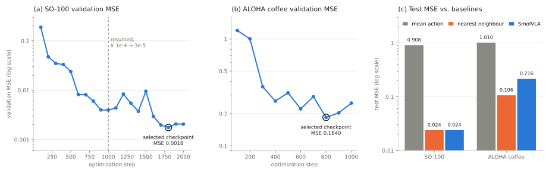

# VLA Finetuning Experiments

This repository is the experiment, training, evaluation, deployment, and feedback layer for vision-language-action (VLA) policies. It fine-tunes the public SmolVLA checkpoint on versioned robot-demonstration datasets, evaluates it against fixed held-out splits and two baselines, and turns its failures into a structured recommendation for the next version of the dataset. The distribution is named `vla-finetune`, the Python package `model_training`, and the command-line interface `mtrain`.

The system rests on one organizing principle: **the model layer never owns the data.** Every dataset this package trains on is an immutable, catalog-resolved version produced by the companion repository [Episodic Data Engine](https://github.com/kushagrathisside/Episodic-Data-Engine-For-Cross-Embodiment-Data-Pipelines). Even a data intervention, such as halving the training set or rebalancing it toward a weak regime, is executed as a lineage-tracked transform inside the engine, never as a local copy. A trained model can therefore always be traced back to the exact raw episodes it learned from.

<p align="center">
  
</p>

**Figure 1. System architecture.** `ExperimentRunner.run` executes seven stages in order. Stages 2 to 6 call a data-engine service (left), and every stage writes named artifacts into the run directory (blue text). The feedback artifact's recommended action informs the next data intervention, which produces a new, lineage-tracked dataset version. The dashed arrow marks a decision taken by a person or a later run; it is not automatic.

## 1. What It Does, on Real Data

The system was exercised end to end on two real LeRobot datasets that differ in embodiment, camera count, frame rate, and action dimensionality (Table 1).

**Table 1. Datasets used for fine-tuning.**

| Property | SO-100 pick-place | ALOHA static coffee |
|---|---|---|
| Source | [`lerobot/svla_so100_pickplace`](https://huggingface.co/datasets/lerobot/svla_so100_pickplace) | [`lerobot/aloha_static_coffee`](https://huggingface.co/datasets/lerobot/aloha_static_coffee) |
| Robot | Six-degree-of-freedom single arm | Fourteen-degree-of-freedom bimanual |
| Cameras / rate | 2 / 30 fps | 4 / 50 fps |
| Episodes after QC (train / val / test) | 48 (38 / 5 / 5) | 40 (32 / 4 / 4) |
| Test frames | 1,908 | 4,400 |

One command runs an experiment from its YAML configuration to a complete run directory:

```bash
mtrain train --config configs/experiments/baseline.yaml
```

The run resolves its dataset through the engine, which records the full provenance of the training version it built. For the SO-100 baseline run, the engine's lineage query returns:

```
$ rde version lineage so100_pickplace training/v6
Lineage of so100_pickplace@training/v6
ancestors: ['clean/v1', 'raw/v1']
  ingest [] -> raw/v1  episodes 0->50
     run=ingest-216cace67957 fingerprint=be45fb09ed2db70c software=0.1.0
  transform ['raw/v1'] -> clean/v1  episodes 50->48  dropped=[9, 31]
     run=transform-10362d8ee7a1 fingerprint=313d63120127b3a0 software=0.1.0
  build_training_dataset ['clean/v1'] -> training/v6  episodes 48->48
     run=build_training_dataset-8960c9184a62 fingerprint=39311367cca30006 software=0.1.0
contributing root episodes: 48
```

Before any training step, an independent check confirms that no episode appears in more than one split, and the run aborts if one does. The run directory records the result (`split_integrity.json`):

```json
{"dataset_id": "so100_pickplace", "version": "training/v6",
 "split_sizes": {"train": 38, "val": 5, "test": 5},
 "train_val_overlap": [], "train_test_overlap": [], "val_test_overlap": [],
 "unassigned_episodes": [], "ok": true}
```

## 2. Measured Results

Table 2 reports the three completed SmolVLA fine-tuning runs. All three start from the public `lerobot/smolvla_base` checkpoint and were trained on a single NVIDIA GeForce RTX 4060 Laptop GPU (8 GB). Each used batch size 4, a learning rate of 1×10⁻⁴ with 50 warm-up steps, and one seed. The continued run resumes from the first run's step-1,000 checkpoint and trains 1,000 more steps at a learning rate of 3×10⁻⁵. Test metrics are computed on each dataset's held-out test split, which is assigned by episode, so no test episode contributes any frame to training. Both SO-100 runs are scored on the identical test split.

**Table 2. Offline test-split results.** MSE is in normalized action units. The ratio is the run's MSE divided by the mean-action baseline's MSE on the same split.

| Run | Dataset | Steps | Test MSE | Ratio to mean-action | Nearest-neighbour MSE | Frames within tolerance¹ | Training time | Peak GPU memory |
|---|---|---:|---:|---:|---:|---:|---:|---:|
| `baseline_full` | SO-100 | 1,000 | 0.0290 | 3.2% | 0.0239 | 49.8% | 324 s | 2.2 GB |
| `baseline_full_extended` | SO-100 | 1,000 + 1,000 | 0.0239 | 2.6% | 0.0239 | 56.9% | 385 s | 2.2 GB |
| `aloha_coffee_baseline` | ALOHA coffee | 1,000 | 0.2157 | 21.4% | 0.1062 | 0.05% | 576 s | 3.0 GB |

¹ The fraction of test frames whose mean absolute action error is below 0.1. It is a proxy defined in [`docs/METRICS.md`](docs/METRICS.md), not a measurement of task success.

<p align="center">
  
</p>

**Figure 2. Training dynamics and test performance.** (a) SO-100 validation MSE across both runs; the dashed line marks the resume point, and the ringed point is the checkpoint selected for testing. (b) ALOHA validation MSE. (c) Test MSE of SmolVLA (the 2,000-step run for SO-100) against both baselines, on a log scale. The figure is generated from the runs' own metric files by [`scripts/plot_results.py`](scripts/plot_results.py).

The results support four statements, and no stronger ones.

1. **Fine-tuning learns the task distribution.** On SO-100, test MSE falls to 2.6–3.2% of the mean-action baseline.
2. **More training helped on SO-100.** The continued run reduced test MSE by 18% (0.0290 → 0.0239) on the identical test split, and validation MSE reached its minimum (0.0018) at step 1,800.
3. **At this budget, SmolVLA matches but does not beat retrieval.** On SO-100 its test MSE equals frame-level nearest-neighbour retrieval (0.0239 against 0.0239). On ALOHA, retrieval is better by a factor of two (0.106 against 0.216). Retrieval is a strong baseline when test episodes come from the same setup as the training episodes, and beating it is the relevant target for further training.
4. **The measurements are open-loop, offline, and single-seed.** No closed-loop rollout or physical-robot success rate is claimed (§10).

### 2.1 Error Metrics

Table 3 gives the full error profile on each test split, including both baselines. Per-frame error is the mean absolute error across action dimensions for one frame; its distribution shows how heavy the error tail is.

**Table 3. Test-split error metrics.** MSE, MAE, and RMSE are in normalized action units. Normalized MAE divides each dimension's MAE by that dimension's standard deviation before averaging.

| Model | Dataset | MSE | MAE | RMSE | Normalized MAE | Per-frame error: median / p90 / p99 / max |
|---|---|---:|---:|---:|---:|---|
| SmolVLA, 1,000 steps | SO-100 | 0.0290 | 0.111 | 0.170 | 0.119 | 0.100 / 0.193 / 0.292 / 0.553 |
| SmolVLA, 2,000 steps | SO-100 | 0.0239 | 0.097 | 0.155 | 0.105 | 0.089 / 0.174 / 0.272 / 0.375 |
| Nearest neighbour | SO-100 | 0.0239 | 0.097 | 0.154 | 0.104 | — |
| Mean action | SO-100 | 0.908 | 0.789 | 0.953 | — | — |
| SmolVLA, 1,000 steps | ALOHA coffee | 0.2157 | 0.341 | 0.464 | 0.347 | 0.314 / 0.525 / 0.732 / 0.910 |
| Nearest neighbour | ALOHA coffee | 0.1062 | 0.236 | 0.326 | — | — |
| Mean action | ALOHA coffee | 1.010 | 0.813 | 1.005 | — | — |

A dash marks a value the run did not record for that model. Continued training on SO-100 shortened the tail more than the median: p99 error fell by 7% (0.292 → 0.272), and the worst single frame fell by 32% (0.553 → 0.375).

### 2.2 Where the Errors Are

**By joint.** Error grows from the base of the arm toward the end effector (Table 4). On ALOHA the left gripper is the hardest dimension at 0.587. The right arm's dimensions range from 0.315 to 0.416, and the left arm's other joints from 0.245 to 0.295.

**Table 4. Per-joint test MAE, SO-100, 2,000-step run.**

| Shoulder pan | Shoulder lift | Elbow flex | Wrist flex | Wrist roll | Gripper |
|---:|---:|---:|---:|---:|---:|
| 0.063 | 0.074 | 0.088 | 0.092 | 0.110 | 0.157 |

**By episode phase.** Mean error binned by normalized episode progress (tenths of each episode) shows where in a demonstration the policy struggles. On SO-100 (2,000-step run), error is lowest at the start (0.051) and the end (0.049) of an episode and peaks in the middle of the episode at 0.144 (50–60% progress). On ALOHA it ranges from 0.265 to 0.402 and is highest in the final tenth of the episode.

**By episode and slice.** Per-episode MAE on SO-100 ranges from 0.085 to 0.111 across the five test episodes (2,000-step run), and from 0.296 to 0.405 across the four ALOHA test episodes. Split into within-split length terciles, long SO-100 episodes are easier (MSE 0.0206) than short (0.0290) and medium (0.0311) ones. The length slices carry no information on ALOHA, because all four of its test episodes are 1,100 frames long and fall into one bucket.

### 2.3 Inference Noise and Compute

SmolVLA generates actions by flow matching from sampled noise, so scoring the same frames twice does not give identical errors. The stratified pass re-scores all 1,908 SO-100 test frames, and its MSE differs from the main pass by up to 5% (0.0305 against 0.0290 for the 1,000-step run, 0.0232 against 0.0239 for the 2,000-step run). The 18% improvement from continued training is well outside this spread, but differences of a few percent between single evaluations should not be read as real.

Each run peaked at 3.0–3.3 GB of host memory and 2.2–3.0 GB of GPU memory (the GPU figures are in Table 2). Model inference took 47–50 ms per frame on SO-100 and 86 ms per frame on ALOHA, which has four cameras and a fourteen-dimensional action space. These figures are prediction time divided by batch size for evaluation batches of 16 frames; they exclude data loading and are not a deployment latency measurement ([`docs/DEPLOYMENT.md`](docs/DEPLOYMENT.md)).

### 2.4 Failure Analysis

On the 2,000-step SO-100 run, the 90th-percentile error rule flags 191 of 1,908 test frames. Every test episode contains some of them, but no episode fails on more than 14% of its frames (range 6.5–13.8%). The feedback artifact therefore classifies the failures as scattered, which points to a model or coverage limitation rather than defective episodes. On ALOHA, 440 of 4,400 frames are flagged, and two of the four test episodes carry most of them (22.6% and 12.1% of their frames). These figures were recomputed from each run's saved per-frame test outcomes with the current engine. An earlier engine version treated SmolVLA's constant confidence value as low confidence on every frame and flagged the entire split; the current `FeedbackLoop` ignores a confidence that never varies (§3.4).

## 3. Four Properties That Matter

### 3.1 Every Data Intervention Is a Versioned Dataset

A data intervention selects or reweights episodes to test a hypothesis about data quantity or coverage. Table 5 lists the supported kinds. Each one becomes a genuine engine transform, using the `EpisodeSubsetFilter` operator, followed by a dataset build. The result is a new `training/vN` version with its own lineage, so the question "which raw episodes trained this model?" remains a single query.

**Table 5. Supported data interventions.**

| Kind | Selection |
|---|---|
| `full` | Every episode that passed QC; no transform step. |
| `reduced`, `fraction` | A seeded random subset of a stated fraction of episodes. A fraction of 0.0 is honoured as zero episodes. |
| `imbalanced` | Under-representation of one regime, chosen from an actual dataset profile rather than presumed. |
| `rebalanced` | Upweighting of existing episodes in a regime through per-episode sampling weights. |
| `custom` | An explicit episode list with a recorded reason. |

The imbalance variable must come from a measured profile of the data (`mtrain profile`); the shipped `imbalanced` and `rebalanced` configurations are templates that must be resolved from a profile with `mtrain build-intervention` before they can be run. On SO-100, every episode carries the same task instruction, so episode length, split into within-dataset terciles, is the variable used in practice ([`docs/EXPERIMENTS.md`](docs/EXPERIMENTS.md)).

### 3.2 The Test Split Is Protected by Construction and Verified Independently

Splits are assigned once, by episode, inside the engine. The package re-derives the partition from the dataset view itself and raises `SplitLeakageError` on any overlap (§1). Validation during training uses the validation split only, and the test split is scored once, after the checkpoint has been selected.

### 3.3 Only Verified Checkpoints Can Be Selected

Every checkpoint is verified immediately after it is written: all five required files must be present (`config.json`, `model.safetensors`, the pre- and post-processor files, and `rde_checkpoint_meta.json`). A checkpoint that fails verification is recorded as unverified and can never be selected as the best one, so a process killed mid-write cannot leave a corrupt "best" model behind. If the training loop itself fails, the run writes `crash.json` (error, steps completed, checkpoints so far) and releases GPU memory before re-raising.

### 3.4 Failure Analysis Returns Evidence, Not a Verdict

Thresholds are percentiles of the current run, not fixed numbers, because what counts as a large error depends on the action units, the normalization, and the model. Flagged frames are aggregated into ranked episode reviews, and the feedback artifact separates two explanations. If failures are concentrated in a few episodes, those episodes are worth inspecting for collection defects. If they are scattered across many episodes, the model has a coverage limitation. A model failure is never presumed to mean bad data. A model's confidence is used only when it varies across frames; SmolVLA reports a constant, so it is judged on error alone and the thresholds record `confidence_used: false`. The artifact for any completed run is printed by:

```bash
mtrain analyze-failures --run runs/<date>/baseline_full_extended/seed_0
```

## 4. Quick Start

The data engine is consumed as an editable sibling checkout, not a published package, so both repositories must be cloned into the same parent directory. The second argument to each `git clone` sets the directory name that `pyproject.toml` (`../episodic-data-engine`) and the experiment runner expect:

```bash
git clone https://github.com/kushagrathisside/Episodic-Data-Engine-For-Cross-Embodiment-Data-Pipelines episodic-data-engine
git clone https://github.com/kushagrathisside/VLAFinetuningExperiments vla-finetune
cd vla-finetune
```

Two Python environments are created in the shared parent directory, mirroring the engine's split between a lightweight base install and an optional dependency group for the VLA model (Table 6).

**Table 6. Installation targets.**

| Environment | Purpose | Commands |
|---|---|---|
| `../.venv` (light) | Configuration, profiling, interventions, tracking, reports, the CLI, and the unit and integration tests. No `torch`. | `uv venv --python 3.11 ../.venv`<br>`uv pip install --python ../.venv/bin/python -e ../episodic-data-engine -e ".[dev]"` |
| `../.venv-vla` (full) | Adds SmolVLA fine-tuning and inference through the engine's `vla` extra (`torch`, `lerobot`). | `uv venv --python 3.11 ../.venv-vla`<br>`uv pip install --python ../.venv-vla/bin/python -e "../episodic-data-engine[vla]" -e ".[dev]"` |

The engine ingests and versions a dataset first; the shipped experiment configurations reference `so100_pickplace@clean/v1`:

```bash
source ../.venv-vla/bin/activate
rde run --config ../episodic-data-engine/configs/so100_pickplace.json   # download, ingest, QC, version
mtrain profile --dataset so100_pickplace --version clean/v1           # inspect before choosing an intervention
mtrain train --config configs/experiments/baseline.yaml               # fine-tune, evaluate, report
mtrain compare --runs runs/<date>/baseline_full/seed_0 --runs runs/<date>/reduced_data/seed_0
```

### 4.1 Using the Python API

```python
from model_training.config import load_experiment_config
from model_training.experiments import ExperimentRunner, run_data_fraction_sweep

config = load_experiment_config("configs/experiments/baseline.yaml")
result = ExperimentRunner().run(config)        # one seed; writes runs/<date>/<name>/seed_<n>/
result.training_version                        # e.g. "training/v6", resolvable in the engine
result.summary["test_mse"]

run_data_fraction_sweep(config, fractions=[0.25, 0.5, 1.0])   # varies only the data quantity
```

## 5. Architecture

Table 7 summarizes the responsibility of each module. The dependency runs in one direction only: `model_training` imports `rde`, and `rde` imports nothing from `model_training`. Three additive changes were made to the engine to support this package: `SmolVLAPolicy.fit()` with checkpoint save, load, and verification; an `episode_ids` selector on `Evaluator.evaluate()`; and the `EpisodeSubsetFilter` transform ([`docs/ARCHITECTURE.md`](docs/ARCHITECTURE.md) §4).

**Table 7. Module responsibilities.**

| Module | Responsibility |
|---|---|
| `config/` | Pydantic schema for experiments, training, evaluation, splits, and interventions; YAML loading merged over `configs/base.yaml`. |
| `data/` | Dataset profiling with coverage statistics, the independent split-integrity check, and intervention construction. |
| `training/` | `Trainer`: checkpoint cadence, periodic validation, verified best-checkpoint selection, resource sampling, and crash markers. |
| `evaluation/` | Baselines, error distributions, episode and temporal metrics, and stratified slices, built on `rde.evaluation.Evaluator`. |
| `feedback/` | The structured feedback artifact built from `rde.feedback.FeedbackLoop`. |
| `deployment/` | `ModelArtifact`, the `DeployedModel` runtime with health checks and latency measurement, and `ModelRegistry`. |
| `experiments/` | `ExperimentRunner` (Figure 1) and the data-fraction sweep. |
| `tracking/` | Run directories with reproducibility metadata, and the append-only cross-run JSONL index. |
| `reports/` | Figures, experiment reports, model cards, and comparison tables. |
| `cli.py` | The `mtrain` command-line interface. |

## 6. Shipped Experiment Configurations

**Table 8. Configurations in `configs/experiments/`.**

| Configuration | Intervention | Status |
|---|---|---|
| `baseline.yaml` | `full` | Run (Table 2, `baseline_full`). |
| `baseline_extended.yaml` | `full`, resumed from `baseline_full` | Run (Table 2, `baseline_full_extended`). |
| `aloha_coffee_baseline.yaml` | `full` on ALOHA coffee | Run (Table 2, `aloha_coffee_baseline`). |
| `reduced.yaml` | `reduced`, a seeded 50% of episodes | Runnable; not yet run. |
| `imbalanced.yaml` | `custom`, to be resolved from a profile | Template; resolve with `mtrain build-intervention`. |
| `rebalanced.yaml` | `rebalanced`, to be resolved from a profile | Template; refuses to load until resolved. |

## 7. Command-Line Interface

**Table 9. `mtrain` subcommands.** Each has an equivalent wrapper under `scripts/` for environments in which the console script is not on the path.

| Command | Purpose |
|---|---|
| `inspect` | Print a dataset overview: episode, frame, and task counts, and storage footprint. |
| `profile` | Build and optionally persist a dataset profile, including coverage statistics. |
| `train` | Execute one experiment end to end (Figure 1). |
| `validate` | Report the selected checkpoint's validation metrics for a completed run. |
| `evaluate`, `test` | Re-score a completed run's selected checkpoint against a split (`test` is `evaluate --split test`). |
| `rollout` | Report closed-loop rollout status; always "unavailable", because no simulator or robot is connected. |
| `compare` | Produce a comparison table across completed runs (`--runs` repeated once per run). |
| `analyze-failures` | Print the structured feedback artifact for a completed run. |
| `export` | Copy a run's traceable artifacts into a paper-ready export directory. |
| `build-intervention` | Resolve an imbalanced or rebalanced intervention from an actual dataset profile. |

## 8. Run Directory

Every `mtrain train` invocation creates `runs/<date>/<experiment_name>/seed_<seed>/` and refuses to overwrite a non-empty directory (Table 10). Each run also appends rows to a cross-run index (`experiments/*.jsonl`) that can be queried with `jq`, `pandas`, or DuckDB. Both directories are excluded from version control.

**Table 10. Run directory contents.**

| Category | Files |
|---|---|
| Configuration and identity | `config.resolved.yaml`, `dataset.json`, `model.json`, `environment.json`, `git.json` |
| Data checks | `split_integrity.json`, `dataset_profile.json` |
| Training | `checkpoints/`, `metrics/train.jsonl`, `metrics/validation.jsonl`, `training_outcome.json`, and `crash.json` if the training loop fails |
| Evaluation | `evaluation/baselines.json`, `evaluation/test_overall.json`, `evaluation/stratified.json`, `metrics/test.jsonl`, `predictions/test_outcomes.jsonl` |
| Failure analysis and model | `failures/feedback_artifact.json`, `model_artifact.json` |
| Reports | `reports/experiment_report.md`, `reports/model_card.md`, `reports/figures/*.png`, `summary.json` |

## 9. Documentation and Tests

**Table 11. Documentation index.**

| Document | Content |
|---|---|
| [`docs/ARCHITECTURE.md`](docs/ARCHITECTURE.md) | Pipeline stages, the system boundary, the modifications made to the data engine, module organization, and known limitations. |
| [`docs/API_REFERENCE.md`](docs/API_REFERENCE.md) | Every CLI command, configuration field, and public Python interface, with common workflows. |
| [`docs/EXPERIMENTS.md`](docs/EXPERIMENTS.md) | The shipped configurations, the choice of imbalance variable, evaluation slices, and seed policy. |
| [`docs/METRICS.md`](docs/METRICS.md) | Formal definitions of every computed metric, grouped by grain. |
| [`docs/FAILURE_ANALYSIS.md`](docs/FAILURE_ANALYSIS.md) | Failure extraction, ranking, stratification, and the evidentiary standard for candidate causes. |
| [`docs/DEPLOYMENT.md`](docs/DEPLOYMENT.md) | The model artifact format, loading procedure, health checks, and latency measurement. |
| [`docs/IMPLEMENTATION_PLAN.md`](docs/IMPLEMENTATION_PLAN.md) | Findings from the initial inspection of the data engine and the resulting implementation plan. |

```bash
../.venv/bin/python -m pytest tests -q            # 52 unit + integration tests; the smoke test skips without torch
../.venv-vla/bin/python -m pytest tests/smoke -q  # real SmolVLA optimization steps on a tiny synthetic dataset
```

The unit and integration tests run against a synthetic dataset in the real LeRobot v3.0 layout, generated by the engine's `rde.testing` module, with no network access and no mocks of the source format.

## 10. Scope and Limitations

1. **Offline evaluation only.** All reported metrics are open-loop action-prediction errors on held-out demonstrations. `mtrain rollout` reports closed-loop evaluation as unavailable rather than estimating it.
2. **Single-seed, small-budget runs.** Table 2 comes from one seed and at most 2,000 optimization steps on a laptop GPU. It establishes that the pipeline works end to end and provides reference points; it is not a hyperparameter study.
3. **No calibrated confidence for SmolVLA.** The model exposes no uncertainty estimate, so it reports a constant confidence and the feedback loop judges it on error alone.
4. **Single-node, local deployment.** `DeployedModel` is an in-process runtime with health checks and per-stage latency measurement. No network service, queue, or orchestration layer is implemented.
5. **Tracking-layer constraints.** The JSONL index has no file locking and is safe only for sequential runs. `ModelRegistry` is implemented and tested but is not called by `ExperimentRunner`. Only a training-loop failure writes a `crash.json` marker. All three are documented in [`docs/ARCHITECTURE.md`](docs/ARCHITECTURE.md) §8.

## Acknowledgements

The fine-tuning experiments reported in §2 were run by [AdityaKishore0698](https://github.com/AdityaKishore0698) (SO-100 pick-place) and [chytra3](https://github.com/chytra3) (ALOHA static coffee).

## License

MIT. See [`LICENSE`](LICENSE).
